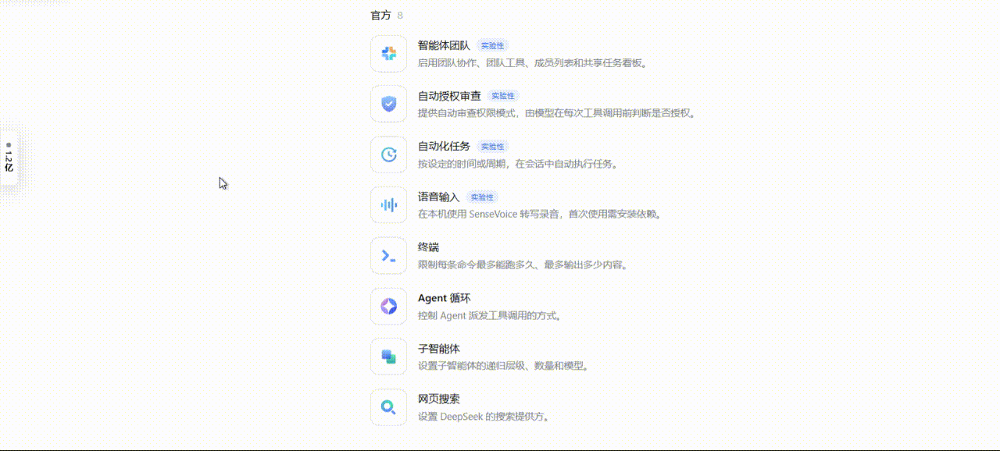
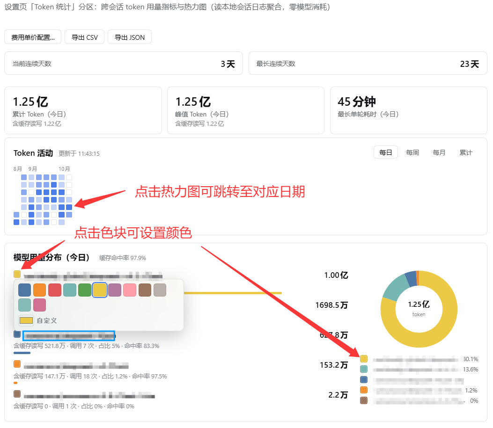
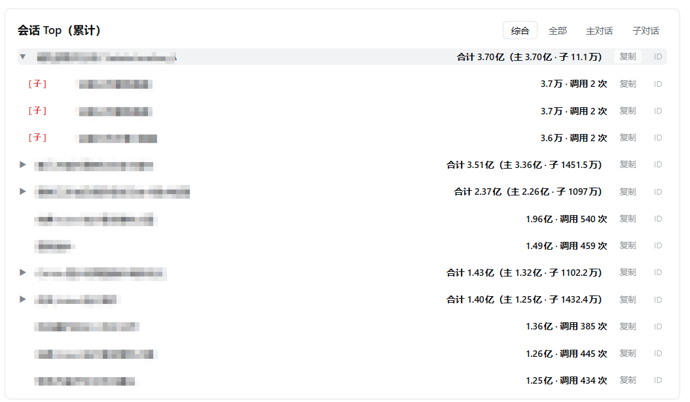

# dsh-token-stats · Token 统计

一个 DSH Web 插件：在设置页新增「Token 统计」分区，展示**跨会话**的 token 用量；并在界面上常驻一个**悬浮小窗**。

全部数据由本地会话日志聚合得出，**不发起任何模型调用**，零 token 消耗。

---

## 效果预览

**常驻悬浮小窗**——可拖动、贴边吸附、双击展开，随时看一眼用量：



**设置页分区**——指标卡、热力图与模型分布；点击热力图方块可跳转对应日期，点击色块可设置模型颜色：



**会话 Top**——按主 / 子代理区分视图，父行显示合计并拆分主 / 子用量：



---

## 目录

- [常驻悬浮小窗](#常驻悬浮小窗)
- [设置页分区](#设置页分区)
- [费用估算](#费用估算)
- [套餐配额与预算告警](#套餐配额与预算告警)
- [会话下钻](#会话下钻)
- [导出](#导出)
- [配置文件](#配置文件)
- [统计口径](#统计口径)
- [数据来源与边界](#数据来源与边界)
- [安装 / 卸载](#安装--卸载)

---

## 常驻悬浮小窗

一个常驻在界面右下角的小窗，默认停靠，用来随时看一眼今日用量。

### 四种形态

小窗有四种形态，尺寸与内容各不相同：

| 形态 | 内容 | 尺寸 |
|---|---|---|
| **吸附态** | 贴边细条：运行状态点 + 竖排今日数字 | 24×74px，贴死屏幕边缘 |
| **折叠态** | 小横条：「Token 统计」+ 齿轮 + 状态点 + 今日数字 | 190×61px |
| **悬浮态** | 完整卡片：折叠态内容 + 热力图 + 图例 + 页脚 + 缩放把手 | 可拖拽调整 |
| **完整历史面板** | 独立浮层：全年热力图 + 汇总（合计 / 活跃天数 / 日均 / 最佳单日） | 820px 宽浮层 |

### 切换方式

| 想做什么 | 怎么做 |
|---|---|
| 从吸附态展开 | **悬停**（临时预览）或**双击**（锁定为完整卡片） |
| 双击完整卡片 | 退回折叠态 |
| 单击 | **不改变**形态 |
| 看全年历史 | 鼠标停在**标题栏**「Token 统计」上约 160ms |
| 拖动位置 | 按住卡片任意位置拖动 |
| 调整大小 | 拖**右下角把手** |
| 折叠 / 展开 | 双击卡片 |

### 小窗功能

- **今日 token**：大字显示当天总量。
- **热力图**：9 周 × 7 天的贡献图，行 = 星期、列 = 周，左侧有「一～日」星期标。
  色深分 5 档，按实际用量四分位自适应。
- **图例**：卡片底部 5 个色块，说明每档大概代表多少用量。
- **点击方块看某天**：点任意方块，主数字切换到该日用量，标签变为「9月30日 token」，
  并出现「回今天」按钮。选中日带蓝色外圈。
- **悬停方块**：显示该日的输入 / 输出 / 缓存读明细。
- **完整历史面板**：贴在上方展开，含月份标与汇总指标；**面板内的方块同样可以点选日期**。
  拖动或缩放卡片时面板自动收起，松手后按新位置重现。
- **状态行**：「近 9 周」+ 数据新鲜度（「刚刚更新」/「N 秒前」/「读取失败」）。
- **运行状态**：有会话在跑时，卡片外框缓慢呼吸变蓝；最后一个会话结束即停止。
  系统开启「减少动态效果」时降级为常亮蓝框。
- **设置直达**：标题栏右侧的 **⚙** 按钮一步跳到本插件的设置页，完整配置表单就在那页上。

### 键盘操作

热力图支持键盘访问：**Tab** 进入网格（只有 1 个格子进入 Tab 序列），

| 按键 | 作用 |
|---|---|
| **← / →** | 跨一周（±7 天） |
| **↑ / ↓** | 跨一天 |
| **回车 / 空格** | 选中该日 |
| **Esc** | 回到今天 |

### 自动停靠

当**窗口未最大化**时，小窗会自动最小化为贴边的细条，只保留一个状态点与竖排今日数字，
尽量少遮挡内容。窗口最大化后自动恢复为完整卡片。

细条中的数字为紧凑格式（保留 4 位有效数字，如「3680万」）；
**悬停细条或读屏可获得精确值**——一眼看大概、悬停看准确，两条路径都在。

### 位置与尺寸的记忆

小窗的位置、尺寸、折叠与停靠状态会记在浏览器 `localStorage` 中，刷新或重启后保持。

---

## 设置页分区

设置页中的「Token 统计」分区，提供完整的用量分析。

### 顶部指标卡

- **连续天数**：当前连续使用天数 / 最长连续天数（全局口径，不随时间页签变化）。
- **累计 Token**：默认随页签周期取值（每日 = 今日、每周 = 本周、每月 = 本月、累计 = 全部历史）。
  **点击热力图方块后**，改为显示所选区块的值，并在括号中标注该区块（如「累计 Token（8月17日～8月23日）」）。
- **峰值 Token**、**最长单轮耗时**：与累计卡同样随页签和区块联动。

### Token 活动热力图

四个时间页签：**每日** / **每周** / **每月** / **累计**。

- 未用时段显示空心方块，有用量的按时段分档填色；
- 悬停任意方块弹出该时段明细气泡；
- 「累计」视图不重复渲染模型列表（模型明细统一由下方「模型用量分布」卡片承载）。

### 模型用量分布

热力图下方的常驻区块，展示**模型行 + 环形饼图**：

- **跟随页签周期**（每日 = 今日、每周 = 本周、每月 = 本月、累计 = 全部历史）；
- **点击热力图方块**即覆盖为该时间区块的模型分布，标题随之更新；
- 每模型一行显示该区块的累计消耗：**含缓存读写、调用次数、占比、缓存命中率**，
  悬停另显示输入 / 输出明细；
- 右侧饼图展示各模型占比，饼心为该区块总消耗；配色按模型名稳定生成（同模型跨区块同色）。

**缓存命中率**口径与 OpenAI 一致：`缓存读 /（输入 + 缓存读 + 缓存写）`，
显示在卡片标题旁、各模型行副行与悬停气泡中。

### 性能时序

展示在「会话 Top」中，口径与 DSH 自带「会话统计」对齐：

| 指标 | 含义 |
|---|---|
| **用时** | 模型响应总耗时（Σ(message.time − step/start)） |
| **工具** | 工具调用次数与总耗时（按 callId 配对求和） |
| **首字** | 平均首 token 时间 TTFT（含 reasoning 时段） |
| **输出** | 输出速度（ΣoutputTokens / Σ耗时，加权平均，单位 T/s） |

行内只保留最主要的信息，工具 / 首字 / 输出等细节放在**行悬停气泡**中；无样本时自动省略对应项。

### 刷新机制

- 打开分区立即拉取数据，可见期间每 **20 秒**轮询一次，切走自动暂停；
- `dsh web` 启动后约 5 秒会后台预热一轮扫描，此后打开分区直接命中缓存（毫秒级）；
- **首次安装**（无缓存）打开需全量解析全部历史日志，约半分钟，之后不再需要。

### 删会话不丢数

DSH 删除会话会连日志一起删掉，本插件会把已解析的结果移入归档区
（`$DSH_HOME/token-stats-cache/archive/`），使历史用量仍然计入统计——**删掉会话后总量不会变小**。

- 归档条目只在该会话已无存活日志时参与统计，不会重复计数；
- 日志重新出现时，归档条目自动移回常规区；
- 归档区上限 2000 条，损坏条目自动跳过、不影响统计；
- 若会话尚未来得及落盘就被删除，这部分日志无法恢复。

---

## 费用估算

点分区顶部的「**费用单价配置…**」打开配置弹窗，为每个模型设置单价。

### 基本单价

每个模型可配置四项单价（单位：**货币 / 每百万 token**）：

| 字段 | 说明 |
|---|---|
| 输入 | 输入 token 单价 |
| 输出 | 输出 token 单价 |
| 缓存读 | 缓存读取单价（免费可填 0） |
| 缓存写 | 缓存写入单价（免费可填 0） |

- 单价可指定币种（¥ 或 $），显示币种在弹窗内切换；
- **各币种分别合计、不做汇率折算**；同时存在时显示为「¥X + $Y」；
- 未配置单价的模型不计入费用；
- 价格输入自动兼容全角数字与全角小数点。

### 时段单价（峰谷价）

每个模型在默认单价之外，可添加多个**价格档**：

- 一个价格档 = 一组四项单价 + 绑定的多个时间段；
- 每个时间段可指定**生效星期**（不选 = 全周），适合「周末全天谷价」这类场景；
- 支持跨零点的时间段（如 22:00～06:00）；
- 时间输入自动补全：输入 `9` 失焦即变为 `09:00`，也支持输入 `930`；
- 费用按用量发生的**本地小时 + 当天星期**匹配，命中任一时间段即整档覆盖默认价；
- 都不命中时使用默认单价。

> 「累计」页签与每日费用为精确值；点击区块后的范围查询不含小时粒度，该卡片费用为默认单价的估算值。

### 历史价

定价行的「**历史价（N）**」按钮展开编辑块，按「**生效起始日 + 当时四项单价**」记录历代价格。

- 某日费用按「起始日 ≤ 该日」的**最后一条**计算；早于全部起始日的日期用该行默认价；
- **典型用法**：把当前价填进默认单价，再补一条「改价那天 + 改价前的价」，历史账单即固定不再变动；
- 不填历史价时，所有日期都按当前价重算；
- 起始日格式为 `YYYY-MM-DD`，填错会在保存时报错拦下。

### 共享定价

一个定价条目可套用多个模型 key（适用于同一模型挂在多个 provider 下、价格完全一致的场景）：

- 模型名旁的「**模型 ×N**」徽标，点击或悬浮弹出勾选面板（带搜索，勾选立即生效）；
- 保存时校验 key 唯一；
- 首项为行主模型（置灰不可取消）；
- **复制按钮**可一键派生新行（含全部价格档，但共享模型不随复制）。

### 模型颜色

「模型用量分布」的图例色块与柱状条行首色块可点击或悬浮，弹出调色盘：

- 12 个预设色 + 原生自定义取色器 + 「恢复自动」；
- 未指定颜色的模型按 key 哈希自动配色；
- 指定色跨会话保留，饼图 / 柱状条 / 图例 / 跨时间区块全局一致。

---

## 套餐配额与预算告警

### 套餐配额

对应 OpenCode Go / Command Code 式订阅。**一个套餐**（名称 + 适用范围）内可并列**多条限额**：

- **适用范围**：全部模型 / provider 前缀 / 指定模型；
- **每条限额**独立设置计量单位（调用次数 / Token 量 / 费用）、统计周期
  （自然月 / 自然周（周一起）/ 滚动 7 天 / 滚动 5 小时）与限量。

**按模型细分额度**（共享总额度池）：额度明细每行 = 模型 + 独立额度 + 当前已用%，同一行紧凑排布。

- 各模型使用率（其已用 ÷ 其额度）**相加**得出汇总行的「总使用率」；
  某模型用满自己的额度即计 100%，汇总可 >100% 表示超用；
- 支持从模型配置**按 provider 整组导入**；
- 总限量与明细可并存，也可只留其一（总限量留空 = 只用明细）；
- 费用限额在配置时**固定币种**，已用只累计该币种的费用，不跨币种折算。

页面上的「套餐配额」卡片按套餐分组展示进度条：**≥80% 黄色预警，≥100% 红色**；
汇总超限时进入顶部告警条并列出超限模型。

### 当前已用百分比（锚点式）

每条限额及每个模型额度明细可填写「**当前已用%**」，用法是：

> **照抄订阅站当前显示的已用百分比**（这个数字已包含本机到填写时刻的消耗）。

保存时插件会记录当时的本机周期用量作为**锚点**，
此后显示比例 = `填写值 − 锚点 + 本机实时用量 ÷ 限量`，
即「填写的值 + 填写之后本机的新增」，不会重复计算填写时已有的消耗。

在别处使用过之后，照抄新的数字重新填一次即可重新锚定。允许填 >100 表示超用。

### 预算告警

可设置**日预算**，支持费用与 token 双口径（任一超标即触发）：

- 超标当天的热力图方块带红圈标注；
- 最新一天超标时，分区顶部展示告警条。

---

## 会话下钻

点击热力图方块后，「会话 Top」卡片展示该时间区块消耗最高的会话（Top 10）。

### 主 / 子代理视图

卡片头部提供四个视图按钮：

| 视图 | 内容 |
|---|---|
| **综合**（默认） | 只列主会话；子代理会话递归折叠到对应父会话下，点父行展开 / 收起 |
| **全部** | 主 / 子平铺混合 |
| **主对话** | 只列主会话 |
| **子对话** | 只列子代理会话（含嵌套） |

- **综合视图**中，父行显示**合计**（主自身 + 全部后代子代理），并拆分标识「合计 X（主 Y · 子 Z）」；
- 无父可挂的孤儿子代理独立成行，带醒目的「[子]」标识；
- 子代理行显示任务名称，悬停气泡包含「父会话」与「子代理任务」信息。

### 会话明细

- 会话名默认为 `工作区编码名/uuid 前 8 位`；若日志中有会话标题（含用户重命名），则优先显示标题；
- **悬停行**展示完整会话目录名与输入 / 输出 / 缓存读写 / 命中率明细气泡；
- 截断的会话名可悬停查看完整名称；
- 行尾提供**一键复制**按钮（复制会话名称）与 **ID** 按钮（复制完整会话目录名）。

---

## 导出

分区顶部的两个按钮：

| 格式 | 内容 |
|---|---|
| **导出 CSV** | 日序列逐日一行，配置单价时附费用列；带 UTF-8 BOM，Excel 直接打开不乱码 |
| **导出 JSON** | totals + days（含双币种费用）+ models（含双币种费用）+ 币种 / 导出时间 |

---

## 配置文件

**`$DSH_HOME/token-stats.cfg.json`** 是全部费用配置的唯一权威存放位置
（Windows 默认位于 `%USERPROFILE%\.dsh\token-stats.cfg.json`）。

包含：定价（`pricesJson`）、套餐（`plansJson`）、模型颜色（`colorsJson`）、预算、显示币种。

- **首次打开**分区页时，会自动把浏览器中已有的旧配置**播种**进该文件；
- 此后在弹窗中**点保存即实时写回文件**；
- 直接编辑该文件后刷新页面即可生效，无需再在弹窗里逐项点；
- 换浏览器或清缓存都不会丢失配置。

浏览器 `localStorage`（键 `dsh-token-stats.cfg.v1`）仅作首帧即时缓存。

### 配置文件结构

`pricesJson` 每个条目的字段：

| 字段 | 说明 |
|---|---|
| `key` | 主模型 key |
| `keys` | 共享同一份定价的其他模型 key 数组 |
| `currency` | `CNY` 或 `USD` |
| `input` / `output` / `cacheRead` / `cacheWrite` | 默认单价（每百万 token） |
| `tiers` | 价格档：四项单价 + `ranges: [{s, e, days}]` |
| `rates` | 历史价：`[{from: "YYYY-MM-DD", input, output, cacheRead, cacheWrite}]`，按生效起始日升序 |

某日费用取「`from ≤ 该日`」的最后一条历史价；早于全部 `from` 的日期使用默认价。

### 让 AI 帮你改价

把新价写进默认价四项，并在 `rates` 里补一条「改价生效日 + 改价前的价」，历史费用即固定不再漂移。

---

## 统计口径

**合计 = 输入 + 输出 + 缓存读 + 缓存写**，与 DSH 聊天统计条一致
（各平台账单均把缓存读写计入消耗，仅单价不同）。所有总量展示处都带缓存读写标识。

**模型归属**：会话中途切换模型会产生多条模型记录，每个用量步骤归属到「序号不晚于它的最近一条模型记录」；
无法归属的用量记为「未知模型」。

**调用次数** = 去重后的用量步骤数（一个步骤 = 一次模型响应）。

**会话标题**：以日志中最新的标题事件为准，因此用户重命名后会自动跟随。

---

## 数据来源与边界

- 数据来自本地会话日志：`$DSH_HOME/sessions/**/session.jsonl.zstd`（旧格式）与
  同目录 `session.v3.jsonl.zstd`（新格式）；两者并存时只读新格式（其为完整历史）；
- 已结束的步骤按下标去重，跨文件复制产生的事件也会被识别并去重，不会重复计数；
- **零模型消耗**：不注册工具、不注册提示词区块、不发起任何 LLM 调用；
- 实时性上限为**秒级准实时**——用量随步骤结束上报，日志按批落盘，因此有数秒延迟，不是逐 token 实时。

### HTTP 接口

宿主半提供两条路由，**仅回环地址（本机）可访问**，供高级用法直接取数：

`GET /token-stats/summary`（可附加 `?hours=1` 获取小时粒度明细）

```json
{
  "totals": { "grandTotal": 0, "grandCache": 0, "peakDay": 0, "peakDayCache": 0, "longestTurnMillis": 0, "currentStreak": 0, "maxStreak": 0 },
  "firstDate": null,
  "days": [{ "date": "YYYY-MM-DD", "input": 0, "output": 0, "cacheRead": 0, "cacheWrite": 0, "total": 0, "maxTurn": 0 }],
  "models": [{ "key": "provider/model", "input": 0, "output": 0, "cacheRead": 0, "cacheWrite": 0, "total": 0, "calls": 0 }],
  "periodModels": { "today": [], "week": [], "month": [] }
}
```

`days` 自首个有用量日起逐日稠密（含零日）；`models` 为全局按模型汇总（按 total 降序）。

`GET /token-stats/summary?from=YYYY-MM-DD&to=YYYY-MM-DD` 按任意日期范围聚合各模型用量（含端点日）。

`GET/POST /token-stats/cfg` 读写配置文件（原子写，请求体上限 512KB）。

---

## 安装 / 卸载

在本插件目录下执行（`<你的 profile>` 填你的 DSH profile 名）：

```
dsh plugin --profile <你的 profile> add "<本插件目录的绝对路径>"
dsh plugin --profile <你的 profile> remove dsh-token-stats
```

**环境要求**

| 依赖 | 版本 |
|---|---|
| DSH | `>=0.1.7-alpha.1 <0.2.0` |
| Node.js | `>=22.15`（读取会话日志依赖 Node 内置的 zstd 解压） |

装好后重启 `dsh web` 生效。本插件没有独立的设置表单，全部配置都在设置分区页内完成。

---

## 许可

本项目以 MIT 许可证发布，详见 [LICENSE](./LICENSE)。

开发过程中参考的第三方项目见 [THIRD_PARTY_NOTICES.md](./THIRD_PARTY_NOTICES.md)。
